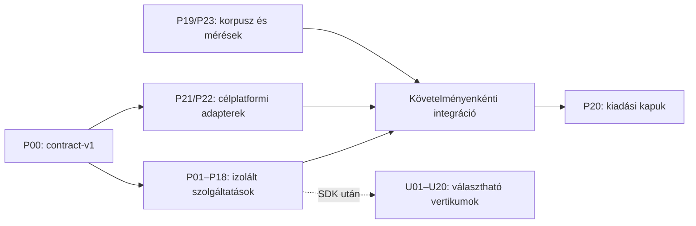

# Párhuzamos fejlesztési csomagok

**24 fő csomag + 20 választható technológiai csomag; mind a 226 auditkövetelménynek pontosan egy elsődleges gazdája van.** Minden termékfejlesztési csomag planned; a jelen munka a terveket és a GitHub-fejlesztési alapot készíti el.

[Közös szerződés és integráció](../superpowers/specs/2026-10-31-parallel-development-design.md) · [Állapotfrissítés](BASELINE_DELTA.md) · [Gépi csomagjegyzék](packages.json) · [226 soros kiosztás](requirement-map.csv) · [Repo/onboarding](REPOSITORY.md) · [44 GitHub-issue](github-issues.json)

[Windows/Linux platformbelépő és közzétett kezdőágak](PLATFORM_DEVELOPMENT.md) · [Mac által vezetett paritásmátrix](PLATFORM_PARITY.md). P21 a teljes Windows, P22 a teljes Linux natív fát birtokolja; közös runtime/CI és központi guidance P00-integráció. A fejlesztői előkészítés nem natív platformelfogadás.

## Párhuzamos indítás

1. P00 rögzíti a contract-v1 DTO-kat, fixture-öket és a modulok bekötési helyeit. Közben P19 tesztkorpusz, P21 Windows környezet és P23 méréstervezés már indulhat.
2. Az első elkészült contract-szelet után egyszerre indítható P01/P02/P03/P04/P05/P08/P09/P10/P12/P14/P18; izolált tesztekhez egymás szolgáltatásait fake port helyettesíti. A többi fő csomag ugyanígy indulhat a saját v1 szerződése után; nincs kötelező teljes csomagsorrend.
3. Bekötéskor követelményenként érvényesek az eredeti függőségek. Az adapterek és a szolgáltatók egymástól független fejlesztése nem jelent provider nélküli készterméket.
4. P20 kiadási jelöltet minősít. P21 Windows natív bizonyítékot ad; P22 Linux külön döntési/portolási program. U01–U20 csak külön választás után kerül a kiadási célba.

A hét P0 követelmény gazdái: P01 (recovery), P09 (buildfüggőség és snapshot), P18 (compilerhatár), P19 (fault bizonyíték), P20 (kiadás), P21 (Windows). Ezt a hat szálat érdemes elsőként ellátni fejlesztővel; P00 a koordinátor. Személynapot és dátumot nem állítunk mértnek: S/M/L/XL az audit relatív becslése, kapacitás nélkül nincs hiteles naptári határidő.

Ez irányítási nézet, nem a csoportosított backlog-függőségek DAG-ja. Az egyedi követelménygráf aciklikus; csomagcsoportosítás után kölcsönös kapcsolatok természetesek.

## Fő csomagok

| ID | Önálló felelősség | Követelmény | Első tesztelhető eredmény |
| --- | --- | ---: | --- |
| [P00](../../docs/superpowers/plans/2026-10-31-parallel/p00-integration.md) | Szerződések és integrációgazda | 3 | Idegen csomag fájlútvonalát tartalmazó manifest ForeignPath hibával elutasított, a v1 fixture oda-vissza veszteségmentes. |
| [P01](../../docs/superpowers/plans/2026-10-31-parallel/p01-recovery.md) | Recovery, bufferéletciklus és helyi előzmény | 10 | r7 nyugtázása utáni megszakításból r7 dirty tartalom visszajön; csonka r8 napló nem ír a lemezre. |
| [P02](../../docs/superpowers/plans/2026-10-31-parallel/p02-transactions.md) | Atomi fájlműveletek és szerkesztési tranzakciók | 7 | Két fájlból a második stale revíziója az egész batch-et elutasítja; az első tartalma és undo-ja változatlan. |
| [P03](../../docs/superpowers/plans/2026-10-31-parallel/p03-runtime.md) | Aszinkron runtime, IPC, FFI és MCP | 10 | Egy félkész kliens határidővel kiesik, közben a második hiteles kliens workspace_info válasza megérkezik. |
| [P04](../../docs/superpowers/plans/2026-10-31-parallel/p04-vfs.md) | VFS, fájlfigyelés és projektmanifest | 4 | Változatlan méret/mtime mellett módosult chapter.tex új hash-t és epochot ad, dirty overlayt nem ír felül. |
| [P05](../../docs/superpowers/plans/2026-10-31-parallel/p05-language.md) | Inkrementális LaTeX nyelvi motor és refaktorálás | 16 | Include-scope fixture-ben az elérhető makró célhelye pontos, dinamikus include esetén coverage Partial és nincs kitalált teljes feloldás. |
| [P06](../../docs/superpowers/plans/2026-10-31-parallel/p06-navigation.md) | Projektkeresés és szemantikus navigáció | 12 | Dirty chapter.tex találata revízióhoz kötött; új snapshot alatt régi lapozókurzor StaleCursor, nem kevert találatlista. |
| [P07](../../docs/superpowers/plans/2026-10-31-parallel/p07-editor.md) | Natív szerkesztői termelékenység | 15 | Többkurzoros beszúrás egy undo-val visszaáll; aktív IME alatt ugyanaz CompositionActive, változatlan tartalommal. |
| [P08](../../docs/superpowers/plans/2026-10-31-parallel/p08-workspace.md) | Beállítások, parancsok és munkaterület | 12 | User→project→profile felülírás determinisztikus, ismeretlen séma hibája megőrzi az eredeti settingsfájlt. |
| [P09](../../docs/superpowers/plans/2026-10-31-parallel/p09-build.md) | Konzisztens fordítás és diagnosztika | 16 | Exit0 és öt nem-PDF byte InvalidPdf; unopened chapter.tex változása mellett a korábbi valódi PDF Stale. |
| [P10](../../docs/superpowers/plans/2026-10-31-parallel/p10-pdf.md) | PDF munkafolyamat és SyncTeX | 12 | Régi generationhöz tartozó SyncTeX cél StaleGeneration; helyes bundle pontos oldalt és forgatott koordinátát ad. |
| [P11](../../docs/superpowers/plans/2026-10-31-parallel/p11-research.md) | Írás, sablonok és publikációs export | 10 | Beadási csomag tartalmazza a szükséges tex/bib/kép/PDF fájlokat, .env és IDE-sessionadat nélkül; stale PDF blokkol. |
| [P12](../../docs/superpowers/plans/2026-10-31-parallel/p12-bibliography.md) | BibTeX adatmodell és kutatói import | 3 | Két azonos BibTeX-kulcs explicit duplikáció; megjegyzés és brace-nested mező lossless újraszerializálható. |
| [P13](../../docs/superpowers/plans/2026-10-31-parallel/p13-git.md) | Git, diff, merge és agentváltozások | 13 | NUL-delimited Git státusz szóközt és sortörést tartalmazó nevet is egy fájlként őriz, index és worktree külön állapot. |
| [P14](../../docs/superpowers/plans/2026-10-31-parallel/p14-assistant.md) | Asszisztens, sessiontörténet és provideradapter | 14 | Panelváltás és reconnect után a draft változatlan; ismételt Stop idempotens, más session eseménye elutasított. |
| [P15](../../docs/superpowers/plans/2026-10-31-parallel/p15-extensions.md) | LSP, plugin SDK és mellékfájlok | 10 | Más API-major és nem engedélyezett capability elutasított; kompatibilis read-only provider nem kap edit jogot. |
| [P16](../../docs/superpowers/plans/2026-10-31-parallel/p16-terminal.md) | Integrált terminál és shellprofilok | 2 | Untrusted projekt profilja nem indul; szóközös shellút argumentumtömbként változatlan, credential-env nem öröklődik. |
| [P17](../../docs/superpowers/plans/2026-10-31-parallel/p17-developer-tools.md) | Task, teszt, debugger és fejlesztői eszközök | 6 | Running→Exited(1) Failed, Running→Deadline TimedOut; végállapot után Started InvalidTransition. |
| [P18](../../docs/superpowers/plans/2026-10-31-parallel/p18-security.md) | Compilerizoláció, trust és adatvédelem | 10 | Compiler projektgyökéren kívüli írása és hálózatkérése elutasított; ez külön OS subprocess-próbával is igazolt. |
| [P19](../../docs/superpowers/plans/2026-10-31-parallel/p19-quality-corpus.md) | Fault injection, korpusz és protokollminőség | 4 | AfterJournalSync kiesés után legalább a nyugtázott revízió visszajön, részleges többfájlos edit soha nem elfogadott. |
| [P20](../../docs/superpowers/plans/2026-10-31-parallel/p20-release.md) | Kiadási minősítés, migráció és csomagolás | 6 | Hiányzó Windows runtime gate vagy eltérő forrás-SHA esetén nincs ReleaseDecision, konkrét hiba van. |
| [P21](../../docs/superpowers/plans/2026-10-31-parallel/p21-windows.md) | Windows 11 x64 natív minősítés és paritás | 4 | msbuild=true, linked=true, launched=true, workflow_passed=false esetén UnrunWorkflow; csak MSVC check nem elegendő natív minősítéshez. |
| [P22](../../docs/superpowers/plans/2026-10-31-parallel/p22-linux.md) | Linux platformdöntés és natív port | 2 | Más tulajdonosú vagy group/world elérhető runtime-dir elutasított; nincs automatikus /private/tmp fallback. |
| [P23](../../docs/superpowers/plans/2026-10-31-parallel/p23-performance-accessibility.md) | Teljesítmény, hozzáférhetőség és használhatóság | 5 | Debug/release vagy eltérő fixture mintái MixedBuildMode/MixedFixture hibát adnak, nem közös szép átlagot. |

## Választható technológiai csomagok

Ezek nem a hallgatói LaTeX-kiadás blokkolói. Egy SDK-adapter önmagában nem jelent teljes JetBrains-termékparitást: minden vertikumnál külön nyelvi/framework/debug/test/projektmodell capability-mátrix és tényleges korpusz kell.

| ID | Terület | Audit-ID |
| --- | --- | --- |
| [U01](../../docs/superpowers/plans/2026-10-31-parallel/u01-jvm.md) | JVM / IntelliJ | UNI-01 |
| [U02](../../docs/superpowers/plans/2026-10-31-parallel/u02-python-data.md) | Python / PyCharm / DataSpell | UNI-02 |
| [U03](../../docs/superpowers/plans/2026-10-31-parallel/u03-web.md) | JavaScript/TypeScript / WebStorm | UNI-03 |
| [U04](../../docs/superpowers/plans/2026-10-31-parallel/u04-php.md) | PHP / PhpStorm | UNI-04 |
| [U05](../../docs/superpowers/plans/2026-10-31-parallel/u05-dotnet.md) | .NET / Rider | UNI-05 |
| [U06](../../docs/superpowers/plans/2026-10-31-parallel/u06-cpp.md) | C/C++ / CLion | UNI-06 |
| [U07](../../docs/superpowers/plans/2026-10-31-parallel/u07-go.md) | Go / GoLand | UNI-07 |
| [U08](../../docs/superpowers/plans/2026-10-31-parallel/u08-rust.md) | Rust / RustRover | UNI-08 |
| [U09](../../docs/superpowers/plans/2026-10-31-parallel/u09-ruby.md) | Ruby/Rails / RubyMine | UNI-09 |
| [U10](../../docs/superpowers/plans/2026-10-31-parallel/u10-database.md) | SQL / DataGrip | UNI-10 |
| [U11](../../docs/superpowers/plans/2026-10-31-parallel/u11-embedded.md) | Embedded/automotive | UNI-11 |
| [U12](../../docs/superpowers/plans/2026-10-31-parallel/u12-games.md) | Játékfejlesztés / Rider | UNI-12 |
| [U13](../../docs/superpowers/plans/2026-10-31-parallel/u13-mobile.md) | Apple/mobil és AppCode-örökség | UNI-13 |
| [U14](../../docs/superpowers/plans/2026-10-31-parallel/u14-dsl.md) | DSL / MPS | UNI-14 |
| [U15](../../docs/superpowers/plans/2026-10-31-parallel/u15-docs-as-code.md) | Docs-as-code / Writerside | UNI-15 |
| [U16](../../docs/superpowers/plans/2026-10-31-parallel/u16-qa-automation.md) | QA automatizálás / Aqua-örökség | UNI-16 |
| [U17](../../docs/superpowers/plans/2026-10-31-parallel/u17-remote.md) | Remote / WSL / devcontainer / web | UNI-17 |
| [U18](../../docs/superpowers/plans/2026-10-31-parallel/u18-collaboration.md) | Valós idejű együttszerkesztés | UNI-18 |
| [U19](../../docs/superpowers/plans/2026-10-31-parallel/u19-enterprise.md) | Enterprise és szervezeti szabályok | UNI-19 |
| [U20](../../docs/superpowers/plans/2026-10-31-parallel/u20-cloud.md) | Cloud/deployment és teljes tool-ökoszisztéma | UNI-20 |

## Átvételi szabály

Egy csomag akkor átvehető, ha saját tesztjei, valódi provideres integrációja és a vállalt platform workflow-ja teljesült; az összes hozzá tartozó követelmény külön bizonyítékot kapott. A PR tartalmazza a contract-verziót, a saját eredménynaplót és a bekötési manifestet. A CI zöld állapota nem helyettesíti az élő natív workflow-t, a recovery fault-próbát vagy a kiadási minősítést.
