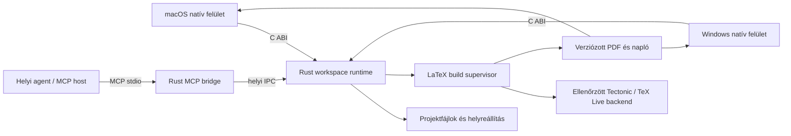

# Natív LaTeX IDE – rendszerterv

Dátum: 2026-10-30  
Állapot: a felhasználó 2026-10-30-án az alábbi pontosításokkal elfogadta; megvalósításra átadva.  
Munkanév: LaTeX IDE. A végleges terméknév nincs eldöntve.

## 1. Cél és elfogadott döntések

Önálló, telepíthető LaTeX IDE készül az egyetem hallgatói számára. Az első verzióban a hallgató a saját gépén tárolja és szerkeszti a projektet, helyben fordítja PDF-re, és külső, helyben futtatott agentet csatlakoztathat MCP-n keresztül.

A felhasználó által kimondott követelmények és döntések:

| Azonosító | Követelmény |
| --- | --- |
| R1 | A saját IDE-t is mi fejlesztjük, önálló alkalmazásként. |
| R2 | Az első verzió helyi munkavégzésre készül. |
| R3 | Csak Apple Silicon (M-sorozatú, arm64) Mac, továbbá Windows 11 x64 Intel és AMD gépeken. Intel Mac, Windows ARM64 és külön 32 bites x86 alkalmazás nem cél. |
| R4 | Közös Rust alkalmazásmag készül. |
| R5 | Két külön natív felület készül; a javasolt és elfogadott irány macOS-en Swift/AppKit–SwiftUI, Windowson C++/WinRT–WinUI 3. |
| R6 | A RAM-hatékonyság és a rendszerintegráció tervezési prioritás. |
| R7 | MCP-kapcsolat szükséges helyi agentekhez. |
| R8 | Beszerzett, nyílt forrású, stabil LaTeX-fordító szükséges, lehetőleg közös megoldással a két platformra; a beszerzés eredetét és integritását ellenőrizni kell. |
| R9 | Az agent MCP-n át külön szerkesztésenkénti jóváhagyás nélkül módosíthat; a felhasználó az IDE-ben visszavonhatja a változtatásokat. |

Az MCP irányának jelenlegi értelmezése: a külső agent az MCP-kliens/host, az IDE a dokumentumokat és műveleteket kínáló szolgáltató. Beépített agentfuttató és tetszőleges MCP-szerverekhez kapcsolódó IDE-kliens későbbi bővítés lehet; a felhasználó ezeket még nem kérte külön.

A további részletek a terv szerzőjének javaslatai. Nem tekintendők korábban kimondott felhasználói döntésnek.

## 2. Mérlegelt megoldások és választás

| Megoldás | Előny | Ráfordítás / korlát | Döntés |
| --- | --- | --- | --- |
| Electron + TypeScript | Közös felület, egyszerű Node-integráció. | Csomagolt böngészőmotor és Node; eltér a választott natív iránytól. | Nem választott. |
| Tauri + Rust + webes felület | Közös felület, rendszer-webview, kisebb alkalmazáskeret lehet. | A felület webview-ban fut; önmagában nem ad AppKit-/WinUI-vezérlőket. | Nem választott. |
| Qt Widgets + C++ | Közös desktop-felület beágyazott böngésző nélkül. | Saját Qt-vezérlők és platformstílusok; külön platformillesztések szükségesek lehetnek. | Mérlegelt alternatíva. |
| Rust mag + két natív felület | Megosztható dokumentum- és fordítási logika, platformonként kialakított natív működés. | Két felület, három programozási nyelv, két platformon szükséges ellenőrzés. | A felhasználó ezt választotta. |

A választott architektúra lehetővé teszi a memóriaigény kézben tartását. Konkrét RAM-előnyt még nem mértünk; a natív technológia önmagában nem teljesítménygarancia.

## 3. Az első kiadás határa

### Az első használható kiadásba javasolt funkciók

- Projektmappa megnyitása, egyszerű mintaprojekt létrehozása és fő `.tex` fájl kijelölése.
- Projektfájlok listája, több megnyitott szövegfájl, alapvető keresés/csere, sor- és oszlopkijelzés.
- Natív szövegszerkesztés, kijelölés, vágólap, undo/redo, alapvető LaTeX-szintaxiskiemelés.
- UTF-8 és UTF-8 BOM kezelése; az eredeti LF/CRLF sorvég és BOM megőrzése mentéskor.
- Kifejezett mentés, módosítottságjelzés, összeomlás utáni helyreállítás, külső fájlváltozás felismerése.
- Beszerzett, verzióhoz és ellenőrzőösszeghez kötött helyi LaTeX-fordító. A kiadási alap TeX Live 2026 + latexmk/XeLaTeX; a Tectonic 0.17.0 advisory-értékelés után kutatási baseline maradt. Más motorok külön kompatibilitáspróbát igényelnek.
- Fordításindítás és megszakítás, értelmezett hibalista és elérhető teljes fordítási napló.
- Beépített PDF-előnézet oldallapozással, görgetéssel és nagyítással.
- Külső agent számára dokumentumolvasás, diagnosztika, fordításkérés és közvetlen, visszavonható szerkesztés MCP-n át.
- A közös működést bizonyító mintaprojektek és platformonként ellenőrzött helyi alkalmazáscsomagok.

### Későbbi bővítések

- Valós idejű közös szerkesztés, központi szerver, fiókok és egyetemi SSO.
- Beépített agent-chat, saját modellhosztolás, automatikus modell- vagy előfizetéskezelés.
- Texlab/LSP-alapú intelligens kiegészítés, hivatkozáskezelő, részletes dokumentumvázlat.
- Kétirányú forrás–PDF navigáció SyncTeX-szel.
- A két PDF-nézet teljes funkcióazonossága: szövegkeresés, kijelölés, annotációk.
- Teljes TeX Live csomagkatalógus menedzselése és automatikus alkalmazásfrissítés. A szükséges alapfordító beszerzése és ellenőrzött telepítési útja az első kiadás része.
- Egyedi egyetemi szakdolgozati sablon; ennek valós forrása és licencfeltétele még nem áll rendelkezésre.

A kezdő felület nyelve magyar, lokalizálható szövegekkel. Támogatási cél macOS 14 vagy újabb, kizárólag Apple Silicon arm64; Windows 11 x64 Intel és AMD processzorral. A felhasználó tisztázta, hogy nem kér külön 32 bites x86 alkalmazást. Windows ARM64 és régebbi rendszerek nem részei az első kiadásnak.

## 4. Folyamatok és felelősségek



A két felület két külön platformalkalmazást jelent. Egy telepítésben a megfelelő natív felület és a belinkelt Rust mag egy alkalmazásfolyamatban fut. Nem fut egyszerre mindkét felület, és nincs külön központi szerver.

| Egység | Felelősség |
| --- | --- |
| Rust dokumentummodell | Tartalom, revíziók, szerkesztési tranzakciók, undo/redo, módosítottság, helyreállítás. |
| Rust workspace | Projektgyökér, fájlazonosítók, fájllista, mentés, külső változások és hozzáférési szabályok. |
| Rust build supervisor | Eszközfelderítés, fordítási sor, gyermekfolyamatok, megszakítás, napló és diagnosztika, kimeneti generációk. |
| Rust FFI adapter | Szűk, verziózott C-felület, parancsbeküldés és események a natív felületeknek. |
| Rust MCP bridge | MCP-protokoll, a kiválasztott futó IDE-session elérése helyi IPC-n keresztül. |
| macOS alkalmazás | Natív felület, AppKit szerkesztőadapter, PDFKit, menük, gyorsbillentyűk, hozzáférhetőség. |
| Windows alkalmazás | Natív felület, szerkesztőadapter, Windows PDF-megjelenítés, menük, gyorsbillentyűk, hozzáférhetőség. |

Az MCP bridge a futó IDE runtime-jához kapcsolódik. Nem hoz létre második, eltérő tartalmú dokumentummodellt ugyanahhoz a projekthez.

## 5. Dokumentumállapot és szerkesztési szerződés

A Rust runtime az egyetlen hiteles, véglegesített dokumentumállapot gazdája. A natív szövegvezérlők a megjelenítéshez saját szövegtárolót használhatnak; ez szükséges másolat, nem külön üzleti állapot.

- Minden dokumentumnak stabil azonosítója és növekvő revíziószáma van.
- A módosítás tartalmazza az alaprevíziót, eredetazonosítót, a cserélendő tartományt és az új szöveget.
- A határokon használt pozíció nulla alapú sor + UTF-16 kódegység szerinti oszlop. A Rust belső UTF-8 tárolása és a natív vezérlők eltérő indexelése adapterben konvertálódik.
- Érvénytelen UTF-16-határ, elavult revízió és érvénytelen tartomány elutasítást kap. Nincs csendes javítás vagy felülírás.
- A felület inkrementális módosításokat küld; gépelésenként teljes dokumentum másolása nem a tervezett adatút.
- Az azonos eredetű esemény nem kerül másodszor alkalmazásra. Az agent által okozott változás ugyanazon eseményfolyamon jut el a felülethez.
- Az undo/redo tranzakciókat a mag kezeli. A platformok parancsai ehhez kapcsolódnak; két független undo-történet nem maradhat aktív. Gépelési csoportok és egy közvetlen agent-művelet külön visszavonható egységet képeznek. Az agent eredete és a tranzakció azonosítója látható.
- IME/marked text közben a natív vezérlő ideiglenes kompozíciót tarthat. Ez csak véglegesítéskor kerül a magba; közben a build és a külső szerkesztés alkalmazása vár vagy egyértelmű állapotot jelez.

### Mentés és helyreállítás

A mentés explicit felhasználói vagy MCP `save_document` művelet. A közvetlen agent-szerkesztés alapból a dokumentumállapotot módosítja, az agent külön művelettel mentheti fájlba. A mentés nem törli az undo-történetet: a már mentett agent-változás is visszavonható, majd az undo eredménye újra menthető. A helyreállítási állomány külön alkalmazásadat. Íráskor ideiglenes fájl és platformfüggő atomi csere szükséges. A módosítottságjelzés csak sikeres mentés után törlődik.

Az undo-garancia az IDE dokumentummodelljén/MCP-jén át végzett változtatásokra vonatkozik. Az IDE-t megkerülő nyers külső fájlírás külső módosításként jelenik meg; ezt nem lehet bizonyíték nélkül ugyanazzal a tranzakciós garanciával ellátni.

A mentés előtti lemezváltozás-ellenőrzés megakadályozza az észrevétlen felülírást. Külső módosításnál a felület újratöltést vagy a saját változat megőrzését kínálja; dirty dokumentum nem töltődik újra automatikusan. A mentési versenyhelyzetek maradék kockázatát platformonként vizsgálni kell, nem elegendő egy korai fájlfigyelő-esemény.

Helyreállításkor a lemezen lévő projekt és a megőrzött változat összehasonlítható. Sérült recovery fájl miatt az eredeti projekt nem írható felül. Nem UTF-8 fájl veszteséges konverzió nélkül, egyértelmű hibaüzenettel marad változatlan.

A kezdeti támogatott szerkeszthető fájlméret legfeljebb 1 MiB fájlonként, 10 egyszerre nyitott szövegfájllal. Nagyobb fájl kezelhető olvasható figyelmeztetéssel és külső megnyitással; az első kiadás nem ígér több száz megabájtos szövegszerkesztést. Ez javasolt, mérhető MVP-határ.

## 6. Natív felületek és FFI

### macOS

SwiftUI kezeli az alkalmazás navigációját, a felületi állapotot, paneleket és parancsokat. Az AppKit `NSTextView`/TextKit szerkesztő és a PDFKit `PDFView` szűk representable/adapter mögött marad. A SwiftUI nem birtokol külön hiteles dokumentumszöveget.

A LaTeX-forrás szerkesztésében ki kell kapcsolni a forrást módosító automatikus idézőjel- és gondolatjelhelyettesítést, rich text beillesztést és hasonló alapértelmezéseket. A TextKit 2 választását és a véletlen TextKit 1 kompatibilitási módba váltás elkerülését prototípussal kell ellenőrizni.

### Windows

C++/WinRT és WinUI 3 kezeli az ablakot, navigációt és platformparancsokat. Az első szerkesztőjelölt a natív `RichEditBox`, szigorúan sima szöveges adapterrel. Ez nem kész kódszerkesztő: a sorvégek, záró bekezdésjel, inkrementális módosítások, IME és undo összekötésének igazolása az M0 része.

Ha a jelölt a dokumentumszerződést vagy az M0 teljesítménypróbáját nem teljesíti, a megvalósító natív Win32 szerkesztővezérlőt választhat izolált adapterben. A választást és a WinUI-hostolást még a teljes szerkesztő megépítése előtt dokumentálni kell. Böngészőalapú szerkesztőre váltás nem fér bele az elfogadott architektúrába.

A PDF-hez elsőként a `Windows.Data.Pdf` oldalrenderelését vizsgáljuk. Az MVP Windows-nézete lapozást, görgetést és nagyítást biztosít, saját korlátozott oldalcache-sel. Nem ígérjük, hogy a rendszer API önmagában PDFKit-szintű kijelölést és keresést ad. Ha az M0 PDF-próbája elbukik, más natív PDF-könyvtár kiválasztása külön dokumentált mérnöki döntés.

### Közös FFI-szerződés

- A Rust stable eszközlánc és a függőségek verziója rögzített; nightly nem szükséges.
- Platformonként buildelt Rust statikus könyvtár kapcsolódik a felülethez: macOS `.a`, Windows MSVC `.lib`.
- A határon C ABI, átlátszatlan handle, fix szélességű számok és egyértelműen felszabadítható bájtpufferek szerepelnek; Rust `String` vagy C++-objektum nem lépi át közvetlenül a határt.
- A kezdeti parancs-/esemény-adatmodell verziózott UTF-8 JSON. A nagy tartalom szeletelve kérhető le; az inkrementális szerkesztések elkerülik a folyamatos teljes másolatokat.
- A kérésbeküldés és eseményátvétel nem blokkolja a UI-szálat. A mag csak jelzi, hogy esemény olvasható; a platformadapter a saját főszálára továbbítja a megjelenítést.
- A puffert a létrehozó allocatorhoz tartozó Rust felszabadító függvény engedi el. A leállítás lezárja a gyermekfolyamatokat és eseményforrásokat, mielőtt a handle felszabadul.
- Rust panic és C++ exception nem léphet át a nyelvi határon. A várt hibák típusos hibakódot és megjeleníthető üzenetet adnak; végzetes állapotból recovery segítségével állunk helyre.

## 7. Helyi LaTeX-fordítás és PDF

Az alkalmazáshoz ellenőrzött beszerzésű helyi fordítót biztosítunk. Eredeti kutatási jelölt volt a Tectonic 0.17.0: hivatalos, nem prerelease kiadásban létezik Apple Silicon arm64 és Windows x64 MSVC csomagja. XeTeX/TeX Live alapú, nyílt forrású megoldás; nem azonos az összes TeX Live motor és külső program teljes körével. A konkrét egyetemi sablonkompatibilitás később valós mintával igazolandó.

Beszerzési feltételek: hivatalos projektkiadás vagy hivatalos forrásból saját build; rögzített verzió és platform; a kiadó által közölt SHA-256/digest ellenőrzése; forrás-/licenc- és függőségeredet rögzítése; ismert biztonsági problémák áttekintése; a rendelkezésre álló aláírás-, reputáció- és kártevőellenőrzés eredményének külön rögzítése. Az upstream hash az eredethez viszonyított integritást bizonyítja, nem abszolút fertőzésmentességet. Bináris vizsgálat, teljes forrásaudit vagy reprodukálható build hiányát nem nevezzük elvégzett ellenőrzésnek.

A beszerzés során végzett advisory-vizsgálat után elsődleges alap a hivatalos TeX Live 2026 + latexmk/XeLaTeX; mindkét platformnak külön beszerzési manifest és működési bizonyíték kell. A már telepített TeX-eszközök opcionálisan használhatók. Felderítésük a GUI-folyamat környezetét, szokásos telepítési helyeket és kézzel kiválasztható programútvonalat kezel; a fejlesztő termináljának PATH-ja nem elegendő bizonyíték.

Az eszközellenőrzés külön jelzi az aktív backend és szükség esetén a `latexmk`, Perl, BibTeX/Biber hiányát. A megnyitás és szerkesztés fordító nélkül is működik. A kezelt fordító és alapcsomagok alkalmazáskönyvtárba települnek, rendszerszintű PATH-módosítás nélkül. A kezdeti csomagbeszerzés hálózatot igényelhet; az elkészült alapmintákat utána hálózat nélkül is le kell fordítani. A helyi tárolás nem jelent automatikusan offline csomagellátást.

A build az explicit módon lementett állapotot használja. Dirty dokumentumoknál az IDE felajánlja a mentést; az MCP buildkérés `needs_save` állapotot ad, és nem ment a hallgató helyett. Az auto-build későbbi, külön kapcsolható funkció.

Workspace-enként egyszerre egy fordítás fut. A felületi és MCP-kérések ugyanabba a build supervisorba érkeznek. Az új kérés a futó művelet azonosítóját kapja vagy foglalt állapotot jelez; nem indít párhuzamos fordítót ugyanabba a munkamappába.

Argumentumlistával, shell közbeiktatása nélkül indítunk folyamatot. Tectonic esetén `--untrusted`, TeX Live esetén kikapcsolt shell escape és `latexmk`-konfigurációbetöltés az alap. Ez nem teljes operációs rendszerszintű sandbox: a TeX folyamat a felhasználó jogosultságaival fut. A megbízható eredetű fordító sem tesz minden bemeneti TeX-projektet biztonságossá.

A build állapota `queued/running/succeeded/failed/cancelled/timed_out`, műveletazonosítóval. Javasolt alapidőkorlát 120 másodperc, felületen 30–600 másodperc között állíthatóan. Megszakításkor a teljes folyamatfát kell leállítani, majd a terminálást megvárni; a GUI bezárásakor sem maradhat futó fordító.

A munkakimenetek alkalmazáscache-be kerülnek, a többfájlos `\input`/`\include`, képek és bibliográfia működését valódi próbák igazolják. Siker után a megjelenített PDF külön, változatlan buildgenerációként kerül publikálásra. A nézet így nem tart nyitva olyan fájlt, amelyet a következő fordítás felülírna. A cache-takarítás figyelembe veszi a nyitott nézetek által használt generációkat.

A buildhez a mentett források revíziói és lemezállapot-manifeszt tartozik. Fordítás alatti fájlváltozásnál az eredmény elavultként jelenik meg; nem állíthatjuk róla, hogy az aktuális szerkesztőállapotot tükrözi. Az MVP élő projektmappából fordít, teljesen izolált forráspillanatkép nélkül; ez ismert korlát, nem bitpontos reprodukálhatósági garancia.

A diagnosztikák tartalmazzák a buildazonosítót, fájlt, elérhető sor/oszlopot, súlyosságot és eredeti üzenetet. Nem értelmezhető naplórészlet elérhető marad. Hibás buildnél a korábbi sikeres PDF megőrződik, egyértelmű régi-eredmény jelzéssel. PDF- és naplóexport explicit művelet.

## 8. MCP-kapcsolat

Az első transport stdio. Az agent által indított Rust bridge helyi IPC-n éri el a megfelelő futó IDE-sessiont: macOS-en Unix domain socket, Windowson named pipe. Nincs alapból nyitott HTTP-port és nincs mindig futó külön háttérszolgáltatás.

A session azonosítása felhasználóhoz kötött, hozzáférés-korlátozott runtime-könyvtárból történik. Az IPC végpont az adott felhasználóra korlátozott; sessionenkénti capability/nonce szükséges. Titok nem kerül parancssori argumentumba vagy naplóba. Lezárt IDE-nél a bridge egyértelműen jelzi a hiányzó sessiont, és nem hoz létre háttérben második projektállapotot.

Az MCP csak az IDE-ben kiválasztott projekthez ad hozzáférést. A fájlazonosítók workspace-hez kötöttek; path traversal és projektgyökéren kívülre mutató symlink nem bővítheti a bridge jogosultságát. További gyökér engedélyezése külön felületi művelet. A buildfolyamat ettől még nem válik fájlrendszer-sandboxszá.

| Javasolt MCP-művelet | Jelentés |
| --- | --- |
| `workspace_info` | Kiválasztott projekt, nyitott dokumentumok revíziói, buildképességek. |
| `list_project_files` | Lapozott fájllista, buildcache és verziókezelő belső fájlok nélkül. |
| `read_document` | Az aktuális, még nem mentett módosításokat is tartalmazó véglegesített dokumentum, revízióval és tartományos olvasással. |
| `get_diagnostics` | Buildazonosítóhoz és forrásállapothoz kötött diagnosztika. |
| `request_build` | Azonosított, figyelhető buildművelet indításának kérése; dirty állapotban `needs_save`. |
| `apply_edits` | Alaprevízióhoz kötött közvetlen szerkesztés, azonnali felületi frissüléssel és undo-tranzakcióval. |
| `save_document` | Egy dokumentum explicit fájlba mentése, konfliktusvédelemmel, az undo megőrzésével. |
| `get_operation` | Folyamatban lévő vagy lezárt művelet állapota; a kliensnek nem kell speciális hosszúfeladat-támogatást feltételeznünk. |

Az agent-szerkesztéshez nincs külön jóváhagyó párbeszéd. A mag ellenőrzi a revíziókat, majd egy visszavonható tranzakcióként módosítja a dokumentumokat. A felület azonnal frissül. Több dokumentum esetén minden ellenőrzés megelőzi a memóriabeli módosítást; elavult vagy hibás műveletből nem kerülhet be részleges változás. A külön fájlmentések nem alkotnak általános, többfájlos fájlrendszer-tranzakciót; hibánál a sikeresen mentett fájlok állapotát tételesen vissza kell adni.

Egy olvasási darab legfeljebb 64 KiB nyers UTF-8 tartalmat ad. A kliens minden darabhoz revíziót kap; közben változó dokumentumnál új olvasást kell kezdenie. A közös alkalmazásüzenet felső határa 1 MiB kódolt adat; nagyobb tartalom darabolt, túlméretes szerkesztés egyértelmű hibát kap. A külső klienskompatibilitást konkrét kliensverzióval teszteljük, nem a „minden MCP-kliens” állítással.

A helyben futó agent használhat felhős modellt is. Az IDE nem választ helyette modellt és nem ígéri, hogy a csatlakoztatott agent a neki átadott tartalmat kizárólag helyben dolgozza fel. Az IDE saját alapműködéséhez nincs szükség modellre vagy API-előfizetésre.

## 9. Memória, teljesítmény és ellenőrzés

Az első prototípus előtt nincs mért RAM-adat és nincs vállalt MB-határ. Az M0 mérése után rögzítjük a platformonkénti keretet; a két operációs rendszer eltérő memóriamutatói közvetlenül nem hasonlíthatók össze.

Mérési esetek: üres alkalmazás; egy kis projekt; 1 MiB magyar/Unicode forrás és 10 nyitott fájl; 100 oldalas PDF görgetése; öt fordítás; húsz projektmegnyitás/bezárás; MCP kapcsolódás és bontás. Release buildet, eszközt, rendszerverziót, bemenetet és mérési módszert rögzítünk.

Külön közöljük az IDE és Rust mag, az MCP bridge, a fordítófolyamatok és a külső agent/LLM fogyasztását. A PDF-cache, undo-történet és napló megőrzése korlátozott; az első határokat a mérés alapján választjuk ki. A bezárt projekt felszabadítja a dokumentumokat és saját erőforrásait.

| Terület | Érdemi elfogadási próba |
| --- | --- |
| R1–R5: natív alkalmazások | Mindkét platformon elinduló saját alkalmazás, azonos Rust szerkesztési művelettel; a natív felületből végigvitt mentés–fordítás–PDF folyamat. |
| Dokumentumszerződés | Magyar ékezet, emoji, kombináló karakter, LF/CRLF, BOM, hibás UTF-8, IME; mentett bájtok és revíziók ellenőrzése. |
| Módosítások és adatmegőrzés | Elavult agent-patch elutasítása, user/agent undo, külső fájlváltozás, írási hiba, recovery és újranyitás. |
| Build | Egy- és többfájlos LaTeX, képek, bibliográfia, szándékos szintaxishiba, hiányzó eszköz, időkorlát és teljes folyamatfa-megszakítás. |
| PDF | Új generáció megjelenítése régi fájlzár nélkül; hibás build után régi PDF jelzése; nagyítás és oldallapozás mindkét platformon. |
| R6: erőforrások | A fenti release mérések; ismételt bezárás után nem felhalmozódó projektállapot. |
| R7/R9: MCP | Valós kliensből stdio kapcsolódás, dirty dokumentum olvasása, közvetlen szerkesztés, mentés utáni GUI undo/redo és revíziókonfliktus. |
| R8: fordító | Két platformcsomag eredetének és hashének ellenőrzése, helyi működési próba, offline ismétlés; a malware-vizsgálat tényleges lefedettségének közlése. |
| Natív használhatóság | Billentyűzetes alapfolyamat, fókusz, vágólap, VoiceOver/Narrator alapellenőrzés, Windows DPI-skálázás. |

macOS build vagy Rust unit teszt nem igazolja a Windows működését. A Windows-kiadáshoz tényleges Windows 11 x64 környezetben build és futtatás szükséges. Intel Mac-csomag nem készül.

## 10. Megvalósítási sorrend

Ez a szakasz mérföldköveket jelöl, nem végrehajtható feladatokra bontott implementációs terv.

| Mérföldkő | Kézzelfogható eredmény és továbblépési feltétel |
| --- | --- |
| M0: technikai alap igazolása | Rust C ABI + egy minimális natív host mindkét platformon; Unicode, IME/undo adapter, PDF-oldal megjelenítése, memória-alapmérés. A Windows szerkesztő- és PDF-megoldás ekkor véglegesíthető. |
| M1: helyi IDE-folyamat | Projekt megnyitása, szerkesztés, mentés, helyreállítás, helyi fordítás és friss PDF mindkét natív alkalmazásban. |
| M2: agentkapcsolat | Rust MCP bridge és közös runtime, olvasás, diagnosztika, buildkérés, közvetlen revízióvédett szerkesztés, mentés és GUI undo. |
| M3: hallgatói kipróbálásra kész csomag | Alapvető kiemelés/keresés, hibajelzések, hozzáférhetőség, mérési jegyzőkönyv és platformonként ellenőrzött telepítési csomag. Nyilvános terjesztés és aláíróazonosság külön kiadási feladat. |

Az M0 korai kétplatformos próba: a macOS-rész elkészülte után nem tekintjük automatikusan megoldottnak a Windows-részt. Windows-környezet hiányában a független Rust/macOS munka haladhat, a Windows-ellenőrzés állapota viszont nyitva marad.

## 11. Javasolt kódhatárok

```text
crates/latexide-core/       dokumentumok, workspace, közös műveletek
crates/latexide-build/      eszközök, fordítás, folyamatéletciklus, diagnosztika
crates/latexide-protocol/   FFI/IPC közös, verziózott adatmodell
crates/latexide-ffi/        C ABI és platform-független runtime összekötés
crates/latexide-mcp/        stdio bridge és MCP leképezés
apps/macos/                Swift natív alkalmazás és adapterek
apps/windows/              C++/WinRT–WinUI 3 alkalmazás és adapterek
tests/fixtures/            kis LaTeX-, Unicode- és hibásbemenet-minták
docs/                      rendszerterv, későbbi implementációs terv és mérési bizonyíték
```

Ez csak tervezett szerkezet; a mappák és alkalmazásprojektek még nem jöttek létre. A konkrét függőségek, pontos C-függvényaláírások, belső tároló (például rope), natív projektfájlok és buildparancsok az implementációs tervben kerülnek rögzítésre. A megvalósító ezekről az itt leírt szerződések megtartásával dönthet.

## 12. Jelenlegi bizonyíték és nyitott részletek

2026-10-30-án a munkamappa üres volt, meglévő alkalmazáskód és Git-repozitórium nélkül. Az első változás ez a dokumentáció.

A helyi gépen macOS 27.2 arm64, Xcode 27.2 és Swift 6.4.2 érhető el. A Rust/TeX programok nem találhatók a vizsgált PATH-ban és szokásos helyi útvonalakon. Ez célzott felderítés, nem teljes lemezleltár. A lekérdezések Xcode cache/FSEvents figyelmeztetéseket adtak; alkalmazásfordítást még nem futtattunk.

| Tétel | Állapot |
| --- | --- |
| Architektúra és helyi első verzió | Felhasználó által kiválasztva. |
| Részletes rendszerterv | A felhasználó elfogadta Apple Silicon-only, Windows 11 x64, ellenőrzött nyílt fordító és közvetlen agent-szerkesztés pontosításokkal. |
| Rust/FFI/MCP/natív UI megvalósítás | A kezdeti terv óta megvalósítás indult. A tényleges, élő állapotot a `docs/DEVELOPER_HANDOFF.md` vezeti; a teljes kétplatformos elfogadás még hiányos. |
| Windows build- és futtatókörnyezet | Ebben a munkamenetben nincs igazolt hozzáférés. |
| Fordítóval végzett LaTeX-próba, memóriaadat, natív UI-ellenőrzés | Még nem futott. |
| Egyetemi mintasablon, végleges név, terjesztési mód | Későbbi döntés; a technikai kezdéshez semleges mintaprojekt használható. |

Az előző változat független, csak olvasó builder checkje: `/root/native_ide_design_check`, 2026-10-30, eredmény `nothing important left.` Azóta a felhasználó fenti pontosításai bekerültek. Az előző ellenőrzés nem tekintendő az új részek vagy a még nem létező implementáció és teljesítmény igazolásának.

A felhasználó legutóbbi pontosítása elsőbbséget élvez a korábbi javasolt alapértékekkel szemben. Újabb architektúra-jóváhagyás nem szükséges; a következő lépés a megvalósítási terv és annak végrehajtása.

## 13. Elsődleges források

A technológiák létezését és alapvető képességeit támasztják alá. A tervezett integráció sikerét és memóriaigényét nem helyettesítik.

- [OpenAI: Prism közlemény és 2027. január 1-jei leállás](https://openai.com/index/introducing-prism/).
- [Rust: stabilitás és kiadási csatornák](https://doc.rust-lang.org/book/appendix-07-nightly-rust.html).
- [Rust: C ABI és FFI](https://doc.rust-lang.org/nomicon/ffi.html).
- [Hivatalos Rust MCP SDK](https://github.com/modelcontextprotocol/rust-sdk).
- [MCP: architektúra és kliens/szerver szerepek](https://modelcontextprotocol.io/docs/2026-07-28/learn/architecture).
- [Apple: NSTextView](https://developer.apple.com/documentation/appkit/nstextview?changes=l_5), [TextKit](https://developer.apple.com/documentation/appkit/textkit?changes=_8) és [TextKit 2 átállás](https://developer.apple.com/videos/play/wwdc2022/10090/).
- [Apple: PDFView](https://developer.apple.com/documentation/pdfkit/pdfview?changes=l_8&language=objc).
- [Microsoft: WinUI 3](https://learn.microsoft.com/en-us/windows/apps/winui/winui3/).
- [Microsoft: RichEditBox](https://learn.microsoft.com/en-us/windows/windows-app-sdk/api/winrt/microsoft.ui.xaml.controls.richeditbox).
- [Microsoft: PDF-oldal renderelése](https://learn.microsoft.com/en-us/uwp/api/windows.data.pdf.pdfpage.rendertostreamasync?view=winrt-28000).
- [CTAN: latexmk](https://ctan.org/pkg/latexmk).
- [Qt: macOS-integráció és vezérlők](https://doc.qt.io/qt-6/macos-issues.html).
- [Tectonic 0.17.0 hivatalos stabil kiadás](https://github.com/tectonic-typesetting/tectonic/releases/tag/tectonic@0.17.0) és [projekt, működés, licencek](https://tectonic-typesetting.github.io/en-US/).
- [Microsoft: Windows 11 csak 64 bites / ARM64 rendszerként létezik](https://learn.microsoft.com/en-us/windows/win32/dxtecharts/sixty-four-bit-programming-for-game-developers).
